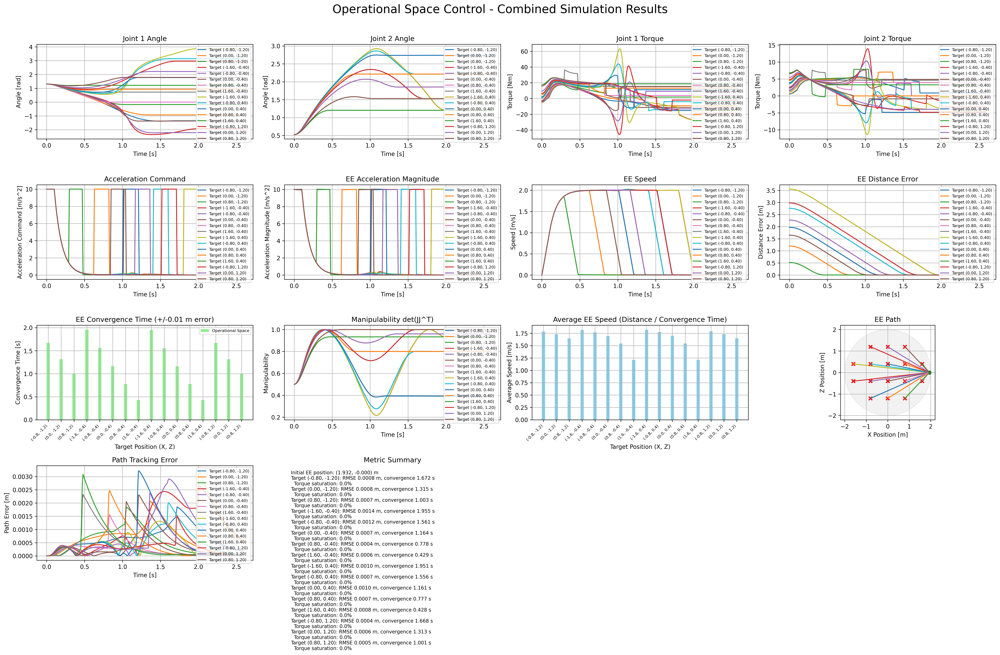
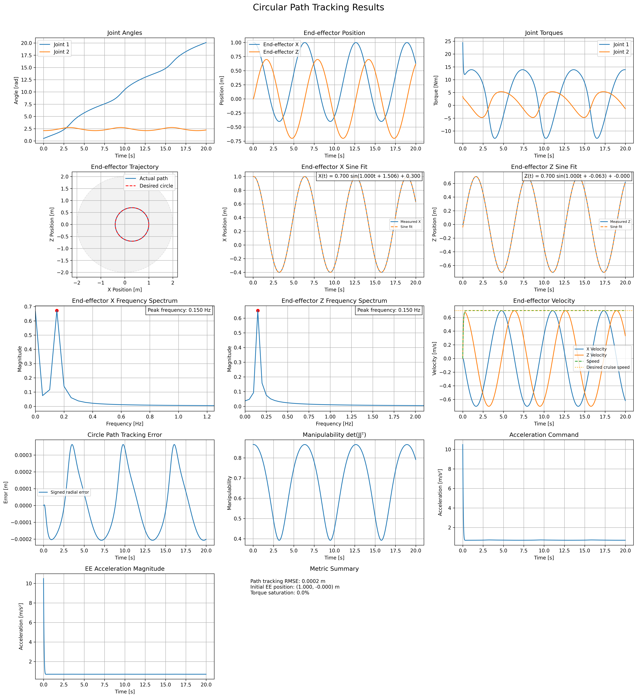
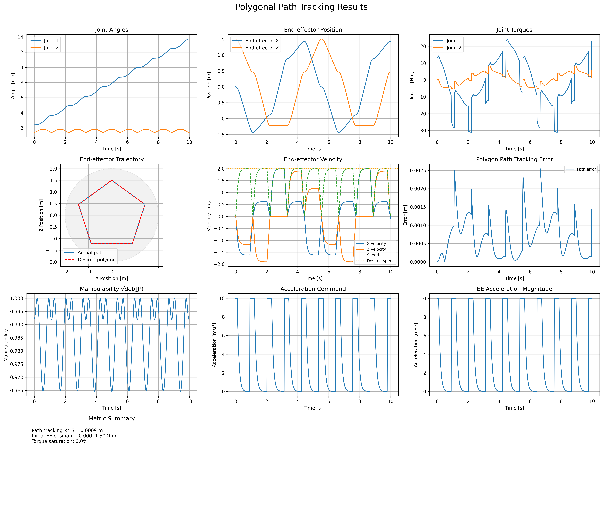

# Operational Space Control for a 2-DOF Manipulator

A Python and MuJoCo simulation project for implementing **operational space control (OSC)** and evaluating Cartesian path-following behavior on a planar two-link robot arm.

The project is a model-based control baseline and an experimental framework. The immediate focus is to make the controller, reference generation, simulation, and evaluation reproducible before studying model mismatch, actuator constraints, and configurations near kinematic singularities. Learning-based compensation is a possible future extension, not part of the current controller.

## Overview

The project currently includes:

- A planar 2-DOF manipulator model implemented in MuJoCo.
- Forward kinematics, Jacobian computation, and robot dynamics.
- Operational Space Control with operational-space inertia and compensation terms.
- Cartesian acceleration commands with feedback-based path following.
- Line, circular, and polygonal path experiments.
- Optional MuJoCo visualization, result plots, and GIF generation.
- Experiment outputs containing configurations, logs, metrics, and figures.
- Unit tests for core kinematics, control, path, metric, and utility modules.

The project is under active development. Results from individual simulations should not be interpreted as general guarantees of stability, robustness, or superiority over other controllers.

## Control Pipeline

The controller follows this sequence:

1. A path object generates a Cartesian reference.
2. The acceleration-command module combines reference acceleration with position and velocity feedback.
3. The OSC controller maps the Cartesian command to joint torques using the robot state and model parameters.
4. MuJoCo advances the simulation and updates the robot state.
5. Metrics and plots summarize path-tracking error, torque usage, saturation, and manipulability.

### Operational Space Control

The operational-space inertia matrix is defined as

$$
\Lambda = \left(JM^{-1}J^T\right)^{-1}
$$

The Cartesian force command is computed using

$$
F = \Lambda a_{\mathrm{cmd}} + \mu + p
$$

The corresponding joint torque is

$$
\tau = J^T F
$$

where:

- \(M\) is the joint-space inertia matrix.
- \(J\) is the end-effector Jacobian.
- \(\Lambda\) is the operational-space inertia matrix.
- \(a_{\mathrm{cmd}}\) is the commanded Cartesian acceleration.
- \(\mu\) and \(p\) denote the implemented velocity-dependent and gravity-compensation terms.
- \(\tau\) is the resulting joint torque.

The implementation regularizes the operational-space inertia calculation numerically. This regularization is not, by itself, a complete singularity-handling strategy. Behavior near low-manipulability configurations remains an important evaluation target.

## Simulation Results

The following experiments demonstrate the current controller's behavior on different reference paths. The figures provide quantitative views of the simulation, while the animations show the resulting robot motion.

### 1. Line Path

The line-path experiment evaluates Cartesian tracking along a straight reference path.

**Simulation results**



**Simulation animation**


### 2. Circular Path

The circular-path experiment evaluates tracking along a curved Cartesian reference.

**Simulation results**



**Simulation animation**


### 3. Polygonal Path

The polygonal-path experiment evaluates tracking along a piecewise-linear reference containing changes in direction.

**Simulation results**



**Simulation animation**


> These figures and animations illustrate selected simulation runs. They do not, on their own, establish robustness to model uncertainty, disturbances, or sensor noise. Such claims require systematic experiments under documented conditions.

## Evaluation Metrics

The project includes metrics for evaluating tracking and control behavior, including:

- **Tracking RMSE:** root mean square Cartesian tracking error.
- **Maximum tracking error:** largest observed tracking deviation.
- **Convergence time:** time required to satisfy the configured convergence criterion, where implemented.
- **RMS torque:** root mean square control effort.
- **RMS torque rate:** root mean square rate of torque change.
- **Torque saturation ratio:** fraction of simulation steps affected by torque saturation.
- **Manipulability:** a measure of the local kinematic capability of the manipulator.
- **Threshold violation ratio and success indicators:** measures associated with configured tracking thresholds.

The available metrics depend on the experiment. Numerical comparisons should use consistent simulation settings and clearly documented evaluation criteria.

## Repository Layout

```text
.
├── model/
│   └── arm_2dof.xml
├── src/
│   ├── control/
│   ├── metrics/
│   ├── path/
│   ├── robot/
│   │   └── arm_2dof/
│   ├── mujoco_setup.py
│   ├── parameters.py
│   └── utils.py
├── simulation/
├── experiment/
│   ├── LinePath/
│   ├── CirclePath/
│   ├── PolygonPath/
│   └── results/
├── tests/
├── pyproject.toml
├── requirements.txt
├── run.py
└── uv.lock
```

## Requirements

- Python version specified by `.python-version`.
- MuJoCo and the Python dependencies specified by the project.
- `uv` for environment and dependency management.

## Setup

Clone the repository:

```bash
git clone <YOUR_REPOSITORY_URL>
cd operational_space_control
```

Create and synchronize the project environment:

```bash
uv sync --locked
```

## Running Experiments

Run an experiment as a Python module from the repository root.

For example:

```bash
uv run python -m experiment.LinePath.simulation
```

Circular and polygonal path experiments can be run similarly:

```bash
uv run python -m experiment.CirclePath.simulation
uv run python -m experiment.PolygonPath.simulation
```

The exact available command-line options depend on each experiment module. Check the module's argument parser for options controlling the viewer, plot generation, and GIF generation.

## Testing

Run the test suite with:

```bash
uv run --locked pytest
```

## Current Limitations

The project is still evolving. Current results should be interpreted within the tested simulation conditions.

Areas requiring further investigation include:

- Tracking performance near kinematic singularities.
- Sensitivity to model-parameter mismatch.
- Effects of torque saturation on tracking.
- Responses to external disturbances and sensor noise.
- Consistent quantitative comparisons across different path geometries.
- Reproducibility across parameter configurations and simulation runs.

## Future Work

Planned directions include:

- Systematic evaluation of tracking performance under model uncertainty.
- Improved handling of singularities and low-manipulability configurations.
- More comprehensive comparisons of tracking accuracy and control effort.
- Reproducible experiment configurations and result summaries.
- Investigation of adaptive or learning-based compensation for limitations that remain after model-based control.

The broader research objective is to understand **when model-based control is sufficient, where its limitations emerge, and when learning-based methods may provide a useful complement**.

## License

No license has been selected yet. Until a license is added, do not assume that the repository is available for unrestricted reuse.